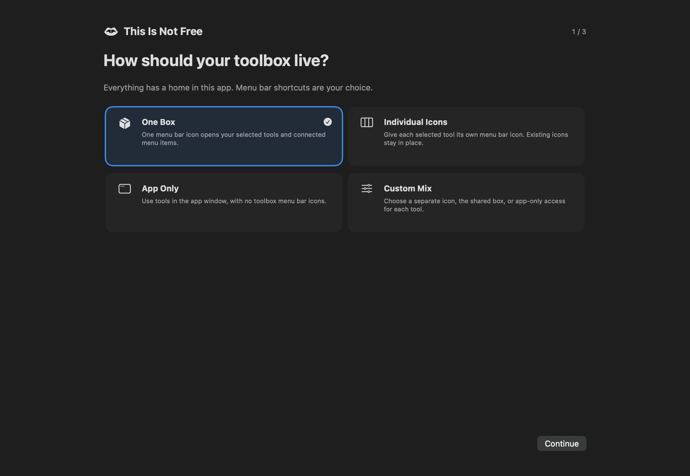
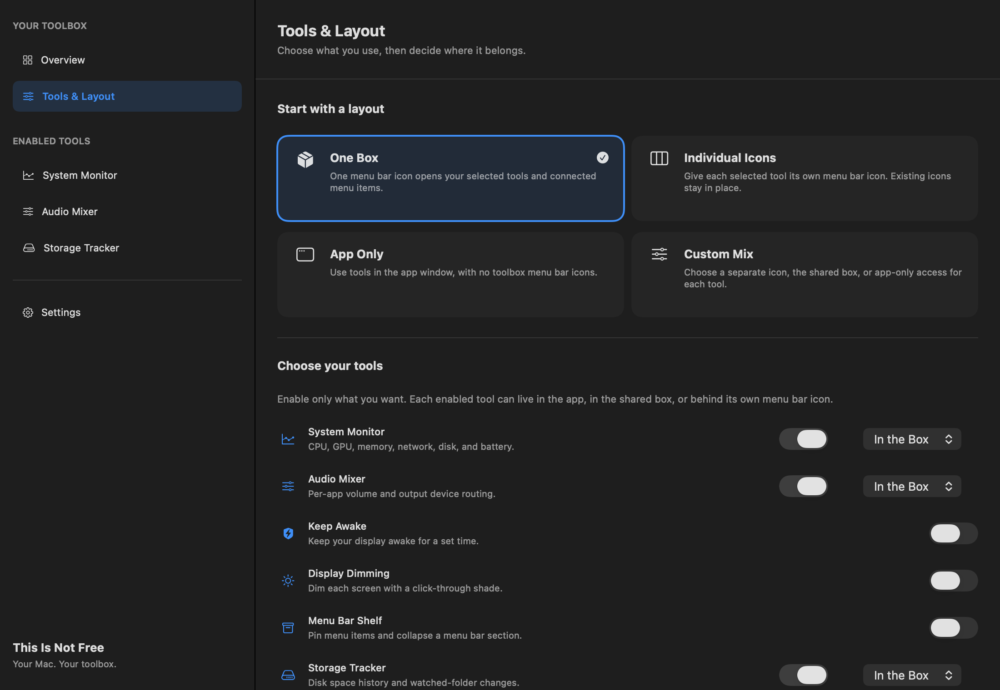

# This Is Not Free

A free macOS utility app with a full toolbox window and optional menu bar shortcuts. Pick your tools, then decide whether to keep them in one box, give each its own icon, use them only in the app, or mix those layouts.

Requires **macOS 14.2 or newer**. Built with SwiftUI, AppKit, and system frameworks. No third-party package dependencies. MIT licensed.



## Install from GitHub

Install Xcode or the Xcode Command Line Tools, then:

```sh
git clone https://github.com/JoonNeuro/ThisIsNotFree.git
cd ThisIsNotFree
zsh Scripts/install.sh
```

This builds and installs `~/Applications/ThisIsNotFree.app`. On first launch, the app window guides you through layout, tool selection, and optional existing menu bar connections. Reopen it from the Dock, **Open App** in a popup, or **⌘1**. Change selections and placement in **Tools & Layout**. Closing the window leaves enabled tools running; use **⌘Q** to quit. To build without installing, run `zsh Scripts/build-app.sh`; the app is created in `dist/ThisIsNotFree.app`.

The app icon shows an exaggerated cartoon lower face forcefully pronouncing the “F” in “FREE,” with ballooned cheeks, a tense philtrum and chin, muted taupe lips, and prominent upper teeth. The shared menu bar icon uses a separate mouth-only template mark for light and dark bars. [Artwork source and generation prompt](Resources/Brand/README.md).

## App window and menu bar layout

The main app window has a sidebar for Overview, Tools & Layout, enabled tools, and Settings. Tools work in that window regardless of their menu bar placement. The app appears in the Dock; reopening the app restores its window. Existing installations keep their enabled tools and receive the new three-step layout setup once.



Choose a starting layout in **Tools & Layout**:

- **One Box:** one toolbox icon opens a compact grid of selected tools and connected menu items. Clicking a built-in tool opens its controls inside that popup.
- **Individual Icons:** every selected built-in tool gets a separate menu bar icon and its own control popup. Existing third-party originals stay in place.
- **App Only:** tools remain available in the main window with no toolbox status icons. The collapsible section is restored and disabled.
- **Custom Mix:** set each enabled tool to **In the Box**, **Own Icon**, or **App Only**. Saved custom groups can also appear in this mode.

Under **Existing Menu Bar Icons**, enable the shelf connection and allow Accessibility. Include all discovered items, including newly discovered ones, or turn off that option and check individual items. Disabling a tool removes its shortcut without losing its saved settings. Layout presets change placements without disabling tools. CPU/GPU percentage indicators are optional additional icons when System Monitor uses **Own Icon**.

Existing-item tiles use their owning app's icon and press the original accessible menu item. They do not reparent third-party status items or recreate their live graphics. Not every system or third-party item is exposed through Accessibility. To conceal originals on supported macOS versions, enable the collapsible section, Command-drag originals to its left, keep the box to its right, and collapse it. Adding a tile alone does not hide the original. See the shelf details below.

## Tools

| Tool | What it does |
| --- | --- |
| System Monitor | CPU, optional GPU utilization, active/wired/compressed memory, disk usage, network rates, and battery level. CPU and GPU indicators can also appear directly in the menu bar. |
| Audio Mixer | Per-app volume, output device volume, and routing apps to different speakers or headphones. |
| Storage Tracker | Startup-disk free-space history, watched-folder size changes, added/removed file counts, largest changes, and optional space alerts. |
| Keep Awake | Prevent idle display and system sleep for 15 minutes, 30 minutes, one hour, two hours, or until stopped. Uses a shield-and-bolt icon. |
| Display Dimming | Independent, click-through software shades for connected displays, with a Restore All button. |
| Menu Bar Shelf | Discover menu items with Accessibility, pin them, and open their original menus. A collapsible section hides icons on supported macOS versions. |
| Groups | Combine Wi-Fi, battery, built-in controls, and other apps' menu items under custom menu bar icons. Choose each group's name, icon, visibility, and item order. |
| Appearance | System/light/dark window and popup style, accent colors, optional colored toolbox icons, and a click-through menu bar tint. |
| GitHub Updates | Check published stable GitHub releases every six hours, show an in-app update message, and optionally send a notification. |
| Launch at Login | Register or remove the app as a macOS login item. |

## Groups and original menu bar icons

Open **Menu Bar Shelf → Menu Bar Groups** in the app and choose **Custom Mix** under Tools & Layout to show custom group icons. Edit the default Essentials group or create a new group. Add Wi-Fi, battery, audio outputs, system metrics, Keep Awake, display dimming, and discovered third-party items. Turn on **Show** to give the group its own menu bar icon. Built-in tools are interactive in the group popup; third-party buttons reveal and press the original menu item. Built-in audio, awake, and display controls must also be enabled in Toolbox Settings.

The shelf uses the owning app's icon as a tile; it does not capture your screen to recreate live third-party status icons. Accessibility is needed to discover and press other apps' menu items. Some apps do not expose an accessible menu item or do not support the Press action.

To hide originals on macOS 14–26, enable the collapsible section, hold **Command**, and drag icons to the left of the **│** divider. **Collapse Icons** pushes that section off-screen; **Reveal Icons**, **Restore Menu Bar**, or **Option-clicking the toolbox icon** brings it back. The section starts expanded each launch. macOS controls item positions and can limit this method in some layouts. Section collapsing is disabled on macOS 27 and newer; shelf shortcuts and groups remain available. macOS's own Menu Bar settings can hide supported system originals separately. Adding an item to a group does not remove its original icon automatically.

## Storage history

Enable **Storage Tracker** in Settings, then open **Storage → Add** to choose folders to watch. No home-folder scan starts automatically. Useful choices include Downloads, project output folders, and specific caches. Each complete scan establishes a baseline; later scans show added, removed, and modified file counts, net allocated-size changes, the largest changed files, and folder summaries. Use the Finder button to inspect a file. The app never deletes files.

While the app runs, startup-disk free space is sampled every minute and watched folders every 30 minutes, with a manual **Scan Now** and cancellation. The chart retains up to 1,440 samples (24 hours with uninterrupted sampling); folder history retains up to 120 scan summaries. Optional notifications report a drop of at least 5 GB between disk samples or less than 20 GB free, at most once an hour. A free-space alert is disk-wide and does not claim a watched folder caused it. Sleep and app downtime create gaps. Historical changes from before the baseline cannot be reconstructed.

Scans read file metadata, including hidden files, and use allocated blocks rather than logical file lengths, so sparse virtual disks are not counted at their advertised maximum size. They do not follow symbolic links, cross volumes, read file contents, or intentionally download cloud-only data. Cloud-only directories are skipped and marked incomplete. Permission errors, scan limits, and incomplete scans preserve the previous baseline and do not report inaccessible files as deletions. Up to eight non-overlapping folders can be watched; each scan is limited to 25,000 entries and two minutes per folder, checked between entries. Choose smaller folders if a scan is incomplete. A blocked filesystem operation may take longer to return. Live scans are not atomic filesystem snapshots.

Folder totals are estimates: APFS clones and hard links may share blocks, and snapshots, purgeable space, system files, and unmonitored folders can affect free space independently. A folder total is not a promise of reclaimable disk space. Access remains subject to macOS privacy settings; select an accessible folder, or allow the app in System Settings → Privacy & Security if macOS denies access.

History, watched paths, and the latest complete per-file metadata baselines stay locally in `~/Library/Application Support/ThisIsNotFree/Storage/`, with owner-only file permissions. Baselines are rewritten only after folder scans, not on every disk sample. Removing a watch removes its local baseline and summary history. Disabling the module stops sampling and scanning but keeps history for the next time it is enabled. No paths or history are uploaded.

## Display and appearance behavior

Display Dimming changes the displayed image through a transparent black overlay. It does **not** adjust the monitor's hardware backlight or use DDC/CI. Brightness is limited to 20–100%, overlays ignore mouse input, and quitting restores the image. No Screen Recording permission is needed.

Menu bar tint is an optional translucent overlay using your accent color. It tints the bar and the icons underneath, ignores clicks, and is removed on quit. It is hidden when the screen reports no visible menu bar; full-screen and auto-hide behavior depend on macOS. Individual third-party icon colors remain controlled by their apps.

Keep Awake uses a macOS power assertion. Closing a laptop lid or choosing Sleep still works. Assertions are released when stopped or when the process exits.

GPU utilization comes from an optional driver-published IORegistry counter. This is not a stable Apple API and may be unavailable; the app displays **—** rather than a made-up value. Network rates count active Ethernet/Wi-Fi interfaces and exclude loopback and VPN tunnel interfaces. Memory shows active, wired, and compressed physical memory, so its number can differ from Activity Monitor's memory-pressure presentation.

## Audio and permissions

Enable **Audio Mixer** and allow **Screen & System Audio Recording**. If no prompt appears, use **Request Audio Access** in the Audio tab. If access was denied, use **Open Privacy Settings**, allow this app, and restart it. The old MacAudioMixer volume and routing preferences are migrated when available; the new app identity needs its own macOS audio permission.

Each process is captured with a Core Audio tap, attenuated, and played through its chosen output. **Original Output** follows the app's existing output device. Saved routes use device UIDs; a disconnected target falls back to the original output and reconnects when the device returns. Saved gains are prepared while known audio processes are idle and new-process notifications trigger a fast connection attempt. The first captured buffer starts at the saved gain. If macOS exposes a process only after audio begins, an original-volume interval before notification is still possible.

Output sliders use writable hardware volume controls when available. Otherwise **Software · active apps** applies gain to accessible tapped apps on that output. Protected audio, exclusive devices, unsupported formats, and audio outside accessible process taps may not be controlled. No audio samples are saved.

## Updates and privacy

The update checker requests `https://api.github.com/repos/JoonNeuro/ThisIsNotFree/releases/latest`. It sends the app version in a User-Agent; GitHub receives the request and normal connection metadata such as the client's IP address. Disabling GitHub Updates stops scheduled checks. Notifications require separate macOS permission. Release links are accepted only from this project's HTTPS GitHub release path. The app does not silently download, replace, or install executables.

Audio, system statistics, dimming, preferences, groups, and accessibility item discovery stay local. The app reads neither clipboard contents nor Wi-Fi SSIDs. It has no analytics or telemetry upload.

## Development and checks

```sh
zsh Scripts/test.sh
zsh Scripts/build-app.sh
```

Tests cover layout presets, mixed placement persistence, enabled-tool icon filtering, layout migration, storage added/removed/grown-file comparisons, incomplete-scan safeguards, sparse-file allocation, nested folders and symlink exclusion, history persistence across relaunch and watch removal, release-version comparison, release-link validation, CPU interval math, system telemetry availability, and synthetic PCM rendering (saved 90% startup, 100→99%, duplex-buffer selection, deinterleaved stereo, and stereo-to-mono downmixing). They do not measure physical speaker output, cross-device routing, or third-party menu interaction.

For local UI layout previews, the app can render only its own views, without capturing the desktop:

```sh
dist/ThisIsNotFree.app/Contents/MacOS/ThisIsNotFree --export-previews "$PWD/dist/Previews"
```

GitHub Actions builds the app and runs the test scripts on macOS for pushes and pull requests.

## Optional signed binary releases

Source installation uses an ad hoc local signature. For a Developer ID signed and notarized archive, configure a signing identity and a `notarytool` Keychain profile, then:

```sh
export MAC_AUDIO_MIXER_BUNDLE_ID="com.joonneuro.ThisIsNotFree"
export MAC_AUDIO_MIXER_VERSION="0.1.0"
export MAC_AUDIO_MIXER_BUILD_NUMBER="1"
export MAC_AUDIO_MIXER_SIGNING_IDENTITY="Developer ID Application: Your Name (TEAMID)"
export MAC_AUDIO_MIXER_NOTARY_PROFILE="ThisIsNotFreeNotary"
zsh Scripts/package-release.sh
```

The script signs with the hardened runtime, submits to Apple's notary service, checks acceptance, staples the ticket, and creates a versioned ZIP with a SHA-256 checksum. See [Apple's notarization documentation](https://developer.apple.com/documentation/security/notarizing-macos-software-before-distribution).

Implementation references: [Apple Core Audio taps](https://developer.apple.com/documentation/CoreAudio/capturing-system-audio-with-core-audio-taps), [power assertions](https://developer.apple.com/documentation/iokit/kiopmassertiontypepreventuseridledisplaysleep), [Hidden Bar's published architecture](https://github.com/dwarvesf/hidden/blob/develop/docs/ARCHITECTURE.md), and [GitHub Releases API](https://docs.github.com/en/rest/releases/releases). This project has no affiliation with Bartender, Jolt of Caffeine, or the referenced projects.
